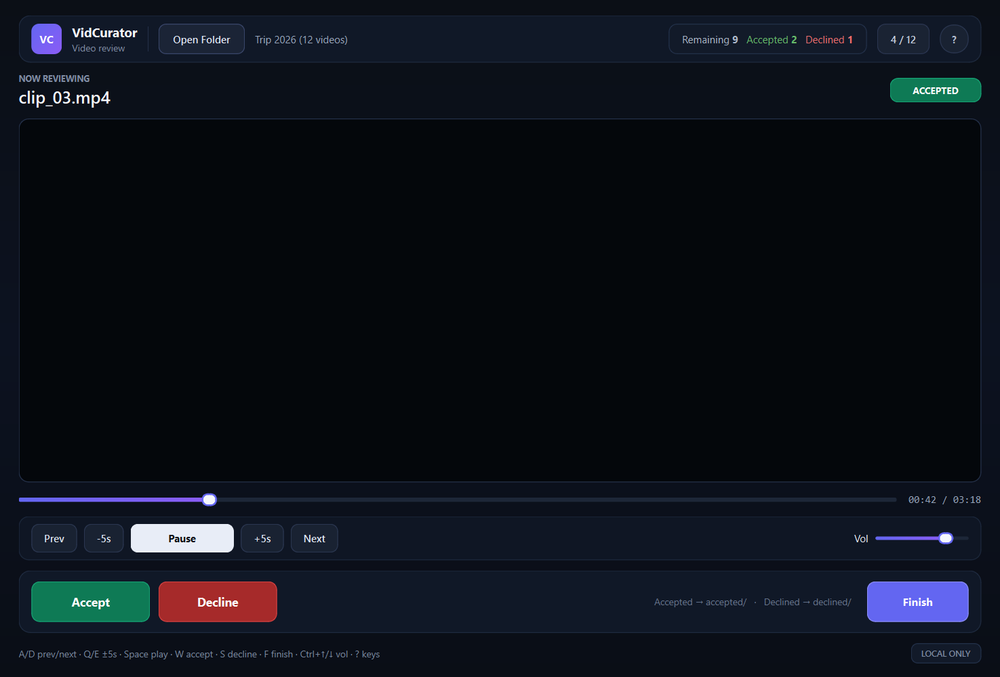

# VidCurator

A local desktop app for quickly reviewing a folder of videos and sorting them into
`accepted/` and `declined/`. Nothing is moved until you press **Finish**.



## Features

- Scans video files in a folder, optionally including subfolders.
- Plays videos inline with seek, volume, and play/pause controls.
- Keyboard-first workflow: mark a clip into a bucket, then jump straight to the next.
- Decisions are saved to `.vidcurator.json` in the reviewed folder, so a restart loses nothing.
- **Ctrl+Z** undoes any number of marks made since the last Finish.
- Buckets are configurable (label + folder); defaults are `accepted/` and `declined/`.
- Decisions are applied only on **Finish**, after a preview of every source and target path.
- Files keep their subfolder (`sub/clip.mp4` → `accepted/sub/clip.mp4`); name collisions are renamed automatically (`clip (1).mp4`).
- Shows size, modified date, duration, and resolution while reviewing.
- Reopening a folder resumes at the first unmarked clip.
- Exports the current decisions as CSV.
- Fully local: no uploads, accounts, or network calls.
- Dark, keyboard-friendly interface built with PySide6.

## Requirements

- Python 3.10+
- Windows, macOS, or Linux with Qt Multimedia support
- On Windows, PySide6 ships the required multimedia backend.

## Install

```powershell
git clone https://github.com/BagasCaturS/Simple-manual-video-curator.git
cd Simple-manual-video-curator
python -m venv .venv
.\.venv\Scripts\Activate.ps1
pip install -r requirements.txt
```

If PowerShell blocks activation, call the venv interpreter directly:

```powershell
.\.venv\Scripts\python.exe main.py
```

On macOS/Linux, activate the environment with `source .venv/bin/activate`.

## Run

```powershell
python main.py
```

## How to use

1. Click **Open Folder** and choose a directory containing videos. Tick **Subfolders**
   to include nested folders.
2. Review each clip. Press **W** / **S** for the first two buckets (default: accept /
   decline), or **1**–**9** for any bucket. The app advances automatically.
3. Press **Ctrl+Z** to undo marks, most recent first.
4. Use **A** / **D** to go back or forward, **Q** / **E** to skip 5 seconds,
   **Space** to play or pause, and **Ctrl+Up** / **Ctrl+Down** for volume.
5. Press **F** (or **Finish**) when done. The dialog lists every move; confirm to apply.
6. Marked files move into their bucket folder (`accepted/`, `declined/`, or your own).
   Unmarked files stay in place.

**Buckets** opens a small editor for the bucket labels and folder names. Each reviewed
folder keeps its own buckets, marks, and subfolder setting in `.vidcurator.json`.
**Export** writes a CSV of the current decisions.

Moved files disappear from the queue on the next scan. With **Subfolders** on, bucket
folders and previously used bucket folders are skipped, so sorted files are not listed
again.

## Keyboard shortcuts

| Key | Action |
| --- | --- |
| `W` / `S` | Mark into bucket 1 / 2 and play next |
| `1`–`9` | Mark into that bucket and play next |
| `Ctrl+Z` | Undo the last mark |
| `A` | Previous video |
| `D` | Next video |
| `Q` | Back 5 seconds |
| `E` | Forward 5 seconds |
| `Space` | Play / pause |
| `Ctrl+Up` / `Ctrl+Down` | Volume up / down |
| `F` | Finish and move marked files |
| `?` | Show shortcuts |

## Supported formats

`.mp4`, `.mkv`, `.mov`, `.avi`, `.webm`, `.m4v`, `.wmv`, `.flv`

Actual playback depends on the codecs available through Qt Multimedia on your system.

## Project structure

```
main.py           UI, playback, shortcuts, review and finish flow
curator.py        folder scanning, move planning, and collision-safe moves
state.py          per-folder buckets and saved decisions (.vidcurator.json)
test_ui.py        UI, undo, resume, and finish-flow tests
test_curator.py   file handling and move-planning tests
test_state.py     sidecar load/save tests
requirements.txt  pinned PySide6 packages
```

## Tests

```powershell
python -m unittest -v
```

The UI tests use Qt's offscreen platform, so they do not open a window.

## Notes

- Files are not moved until you confirm **Finish**.
- Marks are saved as you go, so switching folders or closing the app does not lose them.
  A read-only folder still works for the session, with one warning.
- If a file is still locked by the player, the app waits briefly and retries once.
  Any remaining failures are reported, and their marks are kept so you can press
  **F** again.
- Renaming a bucket's folder only changes future moves; files already moved stay where
  they are. Previously used bucket folders are excluded from subfolder scans.

## License

No license file is included. Contact the repository owner before reusing the code.
